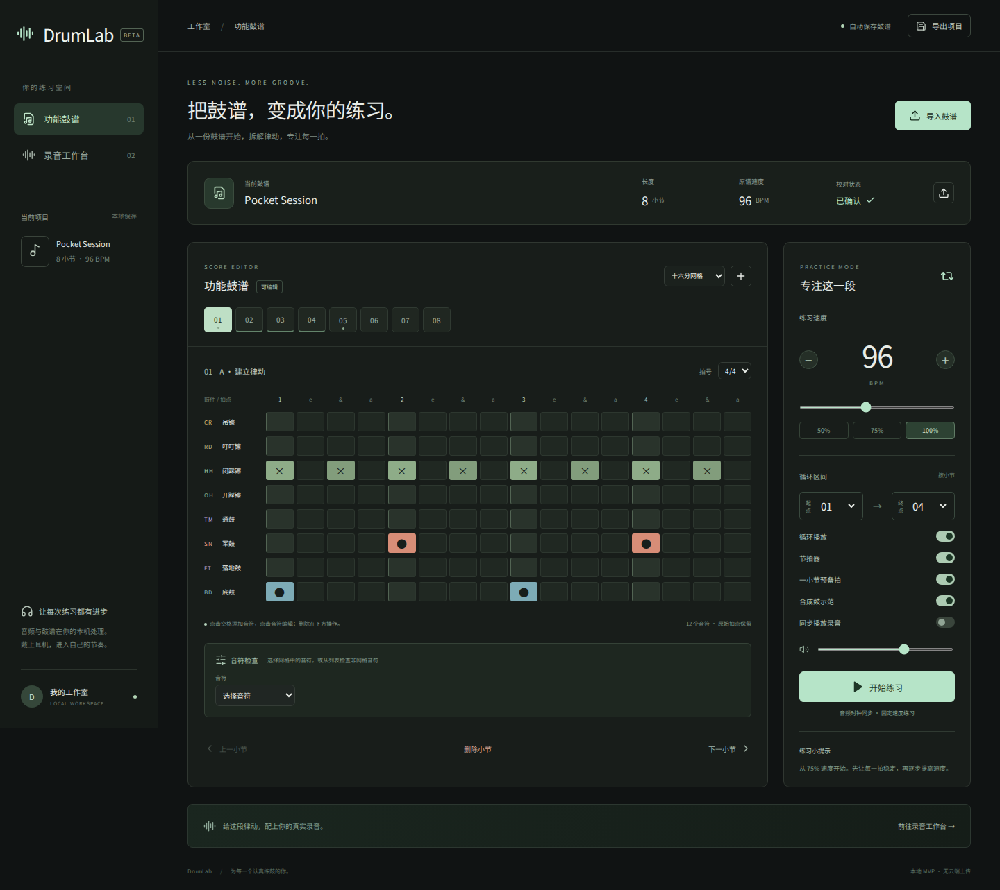
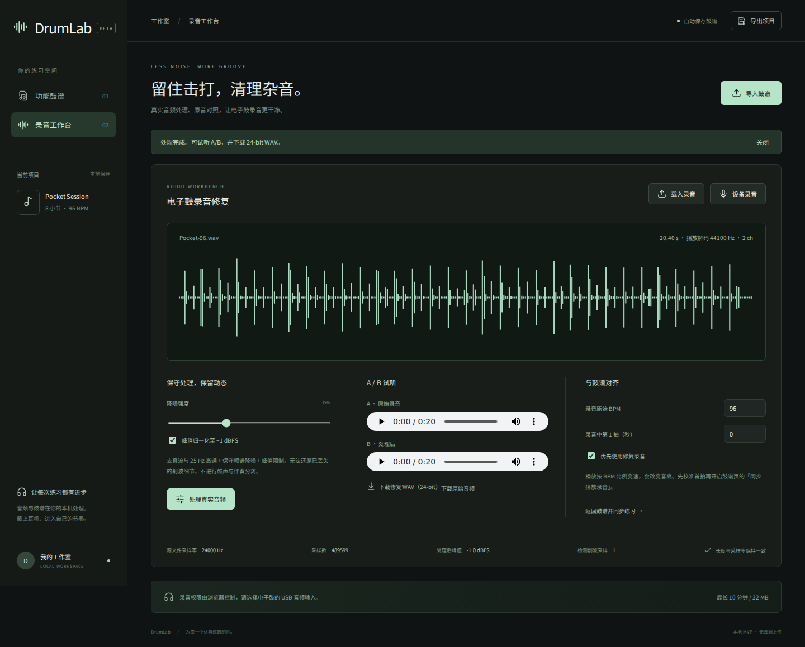

# DrumLab

[中文](README.md) | **English**

A local electronic-drum practice studio. Import a score, edit a groove, clean up a recording, and practice a section at your own tempo. This is an MVP; the application interface is currently in Chinese.



[Quick start](#quick-start) · [Try the samples](#try-the-samples) · [Limitations](#timing-and-limitations) · [Validation record](VALIDATION.md)

## Features

- **Score editing:** import MusicXML/MXL percussion parts, edit notes across eight drum categories, set velocity and hand/foot labels, and add section reminders. Supports chords, multiple voices, tuplets, changing meters, and pickup measures. Imported off-grid note positions are preserved and accessible in the note list. Unknown instruments require manual mapping.
- **PDF reference and correction:** preview the original PDF, extract embedded MusicXML when available, or connect a local Audiveris installation for optical music recognition. When recognition is unavailable or fails, the app creates an explicitly labeled empty correction score for manual entry. Ordinary PDFs do not automatically become notes without a working recognition engine.
- **Recording workbench:** import audio or capture browser microphone/device input. Remove DC offset, apply a zero-phase 25 Hz high-pass filter and conservative spectral noise reduction, optionally normalize to −1 dBFS, and limit peaks. Compare original and processed audio and export processed audio as 24-bit WAV.
- **Synchronized practice:** adjustable BPM, measure-based A/B ranges, looping, a count-in, and independent switches for the metronome, drums, and recording. Practice playback uses a shared Web Audio clock.
- **Local projects:** automatic saving to the local project library and JSON project import/export. The local project library now retains the loaded PDF and recordings. JSON exports include the PDF but exclude audio.

## Quick start

Requires **Python 3.12+** and **Node.js 22.12+**. The recorded validation environment used Python 3.12 and Node.js 24. First-time dependency installation requires an internet connection. Normal operation needs no cloud account or API key.

Open a terminal in the project directory.

### Windows

Double-click `Start-DrumLab.bat`, or run:

```powershell
py run.py --setup --open
```

### macOS / Linux

```bash
python3 run.py --setup --open
```

The setup command creates `.venv`, installs Python and Node.js dependencies, and builds the frontend. Run it on the first launch and after updates that need dependencies or a fresh build.

After setup:

```bash
python run.py --open
```

Use `py` on Windows or `python3` on macOS/Linux if needed. Open **http://localhost:8765**. If the port is occupied, add `--port 8766`. Stop the service with Ctrl+C.

FastAPI serves both the built frontend and the API. A separate frontend server is only needed for development. The launcher binds to `127.0.0.1` by default; the app has no authentication and is intended for local, single-user use. Windows launcher behavior has not been verified end to end; the recorded launcher checks were performed on Linux.

## Try the samples

1. Start with the default eight-measure, 96 BPM funk groove. Click an empty grid cell to add a note; select an existing note to edit or delete it below the grid. Choose the triplet grid to enter triplets.
2. Import `samples/Tuplet-Pocket.musicxml` or `.mxl`. Check simultaneous kick/hi-hat hits, multiple voices, triplets, and the meter change. Use the note list to inspect exact off-grid positions.
3. Import `samples/Manual-reference.pdf`. Without Audiveris, expect an empty correction score beside the PDF reference. Enter notes manually and confirm your review.
4. Open the recording workbench and load `samples/Pocket-96.wav`. This is generated PCM test audio containing noise and DC offset, rather than a human performance. Set its original tempo to **96 BPM** and first-beat offset to **0.20 seconds**. Process, compare, and download it.
5. Load `samples/Pocket-project.json` to restore the demo score. Enable synchronized recording playback and loop measures 1–4 at 72 or 96 BPM. Changing tempo stops playback; restart to apply it.
6. Export the project JSON, refresh, and reopen it. Load the recording separately, since JSON does not embed audio.



## PDF recognition and review

MusicXML parsing and optical PDF recognition are separate capabilities. No recognition accuracy percentage is claimed: there is no labeled dataset of real drum scores, and synthetic fixtures cannot establish accuracy for published or scanned scores.

For optional optical recognition, install Java and [Audiveris](https://github.com/Audiveris/audiveris), set `AUDIVERIS_BIN` to the absolute path of its executable or launcher, and restart DrumLab. The backend invokes:

```text
-batch -export -output <temporary-directory> -- <PDF>
```

The process has a 120-second timeout. Output is read from MXL/MusicXML. A local WSL installation of Audiveris 5.11.0 has now passed a real PDF-to-MXL-to-project import and browser playback test on one drum score; see [the validation report](AUDIVERIS_VALIDATION.md) (Chinese). This does not establish accuracy on other PDFs. Embedded XML extraction and manual fallback have test coverage. You can also correct a score in Audiveris and import its exported MXL.

Review measure counts, meters, rests, simultaneous hits, tuplets, pickups, and drum mappings against the original. Unknown instruments block practice playback until mapped. Optical results always require review and have no calibrated confidence score. High/mid toms share one functional category; imported notes retain their original instrument IDs.

## Timing and limitations

- A 25 ms scheduling task queues events within a 180 ms lookahead. Drum and metronome events use absolute AudioContext times; the playhead reads the same clock with requestAnimationFrame.
- Recordings use native AudioBufferSourceNode loop boundaries. Playback rate is `practice BPM / recording BPM`; source position is `first-beat offset + preceding quarter-note beats × 60 / recording BPM`. Set the original BPM and first-beat offset manually.
- If backgrounding or system suspension makes event scheduling fall behind, playback stops with a message. Actual electronic-drum input/output latency and long-term hardware drift have not been measured.
- Speed changes also change pitch. There is no pitch-preserving time stretching, automatic BPM detection, automatic alignment, or source separation; drum playback now offers recorded sample kits and the original synthesized kit.
- Practice uses a fixed BPM. Imported tempo changes are stored in `tempos` but are not played back. Repeats and D.C./D.S. are not expanded. Grace notes require review; dynamics and expression markings are not fully interpreted, and imported velocity defaults to 90.
- The grid only displays notes aligned to its selected subdivision. Off-grid notes remain in the note list and are played. Do not infer imported note counts from the grid alone.
- Noise reduction can affect cymbal tails. Start with a low setting and compare. Limiting cannot reconstruct information already lost to clipping. Loop boundaries have no crossfade and may click at nonzero waveform cuts.
- WAV/FLAC/OGG files are processed from their original bytes to preserve source sample rate, channel count, and frame count. Other browser-decodable formats and device recordings are converted to 32-bit float WAV at the browser's decoding sample rate before processing. Playback decoding and source-processing sample rates are shown separately.
- Audio is limited to **32 MB**, **10 minutes**, **one or two channels**, and **1–192 kHz**. PDF imports allow up to **40 pages**. MusicXML is limited to **20 MB**, with a **40 MB** total uncompressed limit for MXL archives.
- Device recording requires browser permission on localhost or HTTPS. Select the electronic drum's USB audio input in system/browser settings. The user's actual hardware has not been verified.

## Storage and privacy

Projects are automatically saved to the local backend database at `.local/projects/main.sqlite3`, including scores, reset baselines, original PDFs, recordings and practice settings. The sidebar reopens these projects after refresh. Browser storage is used for legacy migration, active-project selection and unfinished-edit recovery. JSON exports include the score and PDF but not audio, which can be downloaded separately.

Score parsing and audio processing run on the local backend. There are no cloud processing calls or external font requests. The bundled interface font works offline after installation.

## Development

Complete setup first, then use two terminals:

```bash
# Terminal 1 — backend
.venv/bin/python -m uvicorn backend.main:app --port 8765 --reload
```

```bash
# Terminal 2 — frontend
npm run dev
```

On Windows, replace the Python path with `.venv\Scripts\python.exe`. Vite proxies `/api` to port 8765; update `vite.config.ts` if changing the backend port.

```text
src/main.tsx          Score editor and recording workbench
src/model.ts          Project types, validation, demo, and WAV encoding
src/engine.ts         Shared-clock Web Audio transport
src/engine.test.ts    Frontend model and transport tests
backend/main.py       API and built frontend serving
backend/score.py      Safe MusicXML/MXL parsing
backend/audio.py      Audio processing
samples/              Example scores, PDF, audio, and project JSON
tests/                Backend and browser tests
public/sounds/        Licensed recordings and provenance
public/licenses/      Third-party notices
scripts/              Sample and font preparation
public/fonts/         Offline font license
AGENTS.md             Architecture, invariants and agent handoff
run.py                Cross-platform setup and launcher
VALIDATION.md         Recorded results and unverified areas
```

## Testing

```bash
npm test
.venv/bin/python -m pytest -q
npm run build
# Terminal 1: isolated browser-test backend, without OMR (Linux/WSL)
AUDIVERIS_BIN= DRUMLAB_PROJECTS_DIR=/tmp/drumlab-e2e .venv/bin/python -m uvicorn backend.main:app --host 127.0.0.1 --port 8766
# Terminal 2:
npx playwright install chromium
DRUMLAB_TEST_URL=http://127.0.0.1:8766 npx playwright test
```

Use `.venv\Scripts\python.exe` on Windows; in PowerShell set environment variables with `$env:NAME="value"`. The latest [validation record](VALIDATION.md), written in Chinese, reports **55 passing tests**: 17 frontend, 24 backend and 14 browser tests, plus a successful production build. Historical checks and unverified areas remain documented separately; this is not a guarantee for every device.

Coverage includes exact note timing, recording offsets/rates/loops, changing meters, XML/MXL parsing, PDF fallback, audio frame and peak checks, project persistence, device capture with simulated input, and mobile layout. Real optical recognition has additionally been checked on one drum score (see the report above); physical electronic-drum hardware remains unverified.

## Troubleshooting

| Symptom | What to check |
| --- | --- |
| Missing environment or frontend build | Run `run.py --setup --open` from the project directory with the appropriate Python command. |
| Port already in use | Add `--port 8766`; update the Vite proxy as well during development. |
| No notes after PDF import | Configure Audiveris, enter notes manually, or import corrected MusicXML/MXL. An empty fallback score is expected when recognition fails. |
| Recording does not cover the loop | Correct the recording BPM and first-beat offset, or shorten the selected range. |
| Recording disappears after refresh | Reopen the local project from the sidebar. Legacy recordings that were never saved cannot be recovered. |
| Device recording fails | Use localhost/HTTPS and check microphone permission and the selected USB input. |
| Audio format cannot be decoded | Use WAV/FLAC/OGG; other formats depend on browser support. |

## Contributing

Reproduce issues using the included samples where possible. Run checks relevant to your changes. Include your OS, Python/Node.js versions, reproduction steps, and error messages in issue reports. Only share score or recording samples you have permission to distribute.

Virtual environments, Node.js dependencies, and test caches are excluded from version control. Regenerate frontend output with `npm run build`.

## License

No source-code license has been selected for this project yet. The bundled font is an application-specific subset of Noto Sans CJK SC, internally named DrumLab SC, distributed under SIL Open Font License 1.1; see [the font license](public/fonts/LICENSE.txt). Third-party dependencies retain their own licenses.

## Implementation references

- [MusicXML duration](https://www.w3.org/2021/06/musicxml40/musicxml-reference/elements/duration/)
- [Web Audio source scheduling](https://developer.mozilla.org/en-US/docs/Web/API/AudioBufferSourceNode/start)
- [Audiveris CLI](https://github.com/Audiveris/audiveris/wiki/CLI-Arguments)

## Local Audiveris setup

This machine uses a WSL/Linux installation in `.tools/audiveris/`, including its own Java runtime. English OCR data and caches live in `.local/audiveris/`. These machine-local directories are excluded from Git. `run.py` automatically uses `.tools/audiveris-drumlab.sh` if present; an explicit `AUDIVERIS_BIN` takes priority.

On Windows, `Start-DrumLab-WSL.bat` launches this installation through the default WSL distribution, which must match the environment used for setup. The original `Start-DrumLab.bat` uses native Windows Python and cannot directly run the Linux engine.

For the official Ophelia example, select its JazzPerc font and small-note options:

```bash
python3 run.py --open --omr-font JazzPerc --omr-small-notes
```

Use the default settings for ordinary printed fonts. For direct backend startup, set `AUDIVERIS_BIN` to the absolute path of the local wrapper. Optional environment variables are `AUDIVERIS_MUSIC_FONT=JazzPerc` (or `Bravura`) and `AUDIVERIS_SMALL_NOTES=true`. Match settings to the input score.

The import enables percussion processing, handles confirmed zero-based Audiveris percussion exports without shifting standard MusicXML files, and warns about overfull measures while retaining the original events for review.

## Reset and original-PDF playback

After importing a score, use the editor's reset button to restore all imported measures, notes, annotations, and PDF locations after confirmation. The baseline survives autosave and JSON export/import. Legacy autosaved scores without a baseline require reimport; opening a legacy JSON establishes its current content as the baseline.

PDF imports show a rasterized original-page player. Start practice to highlight the current measure and move a beat cursor, with tempo changes, looping, scrolling, and page following. Automatic positions come from Audiveris `.omr` source coordinates and rhythm anchors, not MusicXML's reflowed layout. Mismatched measure counts are not automatically paired.

For missing positions, select a measure, click its locate button, then drag a box on the relevant PDF page. Manual boxes use proportional beat movement. Editing the functional score does not redraw the original PDF. The local project library now retains the PDF across refresh and project switches. Legacy caches without the PDF require one reimport.

## Recorded drum kits and video export

The practice panel offers **Black Pearl** (default, punk/rock-oriented), **Red Zeppelin** (larger, heavier rock drums), and the original lightweight synthesized kit, with an audition button. Both recorded selections come from Glen MacArthur's [AVL Drumkits](https://www.bandshed.net/avldrumkits/): eight drum articulations per kit, with all five original velocity layers (80 recordings total). They are converted to local Ogg Vorbis files (~1.7 MB combined), retaining the original sample rates, channel layouts and full tails. Open hi-hat uses HatSwish. Kit choice is saved with the project, and closed hi-hats choke open hats.

The adapted libraries use the distinct names DrumLab Black Pearl Selection / DrumLab Red Zeppelin Selection. They remain CC-BY-SA 3.0 with the author's exception for produced music; see [sample licensing](public/sounds/LICENSE.txt) and [per-file provenance](public/sounds/manifest.json). No remote sample service is required during playback.

Use the video export button after setting the practice tempo and measure range. Choose the original PDF with a following cursor (all selected measures must have locations), or the functional score grid, and select MP4/WebM and 1–8 passes. The video includes the selected drums, metronome, count-in and synchronized recording switches. Preview, download and cancellation are available.

Videos use local offline mixing and timestamped frame encoding at 1280×720/30 fps, rather than screen or microphone capture. Export speed depends on the device and need not match playback duration. Maximum length is ten minutes, including a half-second tail. Available codecs depend on the browser; a current Chrome/Edge is recommended. MP4 does not imply one fixed video codec.

[Mediabunny](https://github.com/Vanilagy/mediabunny) is loaded on demand for encoding/muxing; its MPL-2.0 license and exact source package are listed in [third-party notices](public/licenses/NOTICE.txt). Sample preparation is reproducible with `scripts/prepare_drum_samples.py`; `scripts/subset_font.py` rebuilds the offline UI font after adding Chinese text (requires fonttools and brotli for development only).

## Local project history

The sidebar groups projects by recent modification time, with score previews, PDF/audio indicators, search, new/import actions, renaming, confirmed deletion and a collapsible mobile drawer. Each import creates a separate project.

The backend stores the full project library in `.local/projects/main.sqlite3`, including original and processed recordings, PDFs, reset baselines, selected drum kit, tempo/range, audio alignment and workspace settings. Switching flushes pending saves and restores the destination project's own media. The status indicator distinguishes saving, saved and failed states. Wait for the saved state before closing while large recordings are being written.

Back up the database file while the service is stopped. `.local/` is excluded from Git; no project history is uploaded to a cloud service. `DRUMLAB_PROJECTS_DIR` can override the local directory. Workspace separation used by browser tests is not authentication; the application remains a local single-user tool.

A small browser recovery snapshot protects unfinished score edits on refresh. Revision checks reject stale writes from another window; a conflicting recovery snapshot is saved as a separate project. First launch migrates the last readable legacy cache. Older overwritten records, and PDFs/audio never stored by the old version, require reimport.

## Audiveris and repository boundaries

DrumLab uses the complete official engine through a small command-line adapter; it does not maintain an Audiveris source fork. The current machine's ignored `.tools/` installation/wrapper is absent on fresh clones. Basic editing, MusicXML import, recording and video export do not require Audiveris.

For optical PDF recognition on another machine, install a matching native package from [official releases](https://github.com/Audiveris/audiveris/releases) (5.11.0 was tested), point `AUDIVERIS_BIN` to its actual CLI executable, then start DrumLab. Follow the package's runtime requirements; neither Java nor the engine is bundled in this repository. Native Windows executables and WSL/Linux binaries are separate.

The production `dist/`, licensed sample selections, fonts and small test fixtures are intentionally tracked. Local libraries, personal media/exports, runtimes, dependencies, credentials and test artifacts are excluded. Future agents should start with [AGENTS.md](AGENTS.md).
