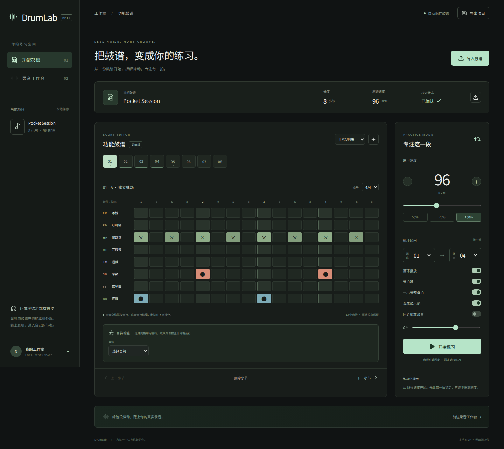

# DrumLab

**中文** | [English](README.en.md)

本地电子鼓练习工具：导入鼓谱、编辑律动、处理录音，再按自己的速度分段练习。当前为 MVP，应用界面为中文。



[快速启动](#启动) · [示例体验](#试用路径) · [功能边界](#同步策略与限制) · [验证记录](VALIDATION.md)

一个可在本机运行的电子鼓练习工作室。React + TypeScript 前端、FastAPI + NumPy/SciPy 音频后端，支持功能鼓谱编辑、录音处理、分段循环和同一音频时钟同步播放。

## 功能

- MusicXML / MXL：解析 percussion 声部、GM 鼓件映射、和弦、backup/forward、多声部、原始有理数时值、三连音、拍号与弱起。原始非网格拍点保留，列表可以精确修改。未知映射必须人工确认。
- PDF：导入并预览原文；优先提取内嵌 MusicXML；可接本地 Audiveris 自动识谱；失败时建立明确标注的空白校正谱。可逐小节补谱、修改拍号、增加/删除音符、映射鼓件、填写手脚与段落提示、确认校对。**未安装 Audiveris 时，普通 PDF 不会自动转为音符。**
- 真实录音：文件导入或浏览器设备录音；去直流、25 Hz 零相位高通、保守频谱降噪、可选 −1 dBFS 峰值归一化与硬限制；原音/处理后互斥试听；保留 WAV / FLAC / OGG 原文件，浏览器录音转 32-bit 浮点 WAV；修复后导出 24-bit WAV。
- 原谱动态播放与复位：支持基于 PDF 原稿坐标的小节高亮、移动拍线、自动翻页和手动框选；修改后可恢复导入版本。
- 音色与视频：Black Pearl / Red Zeppelin 真实采样鼓组及原版合成音色，支持原 PDF 或功能谱的 MP4 / WebM 视频导出。
- 练习：可调 BPM、A/B 小节区间、循环、预备拍、独立开关节拍器/鼓声/录音。所有练习声音使用同一个 AudioContext 时钟。录音需手动校准原始 BPM 与首拍偏移。
- 保存：项目历史和快照保存在本机 `.local/projects/main.sqlite3`，包括编辑后的鼓谱、复位基准、原 PDF、录音、音色和练习设置。浏览器缓存用于迁移旧版和恢复未完成的保存。JSON 项目导出仍不包含录音，可单独下载音频。

## 启动

需要 Python 3.12+（已测 3.12）、Node.js 22.12+（已测 24），首次安装需要联网。运行后无需云端账户或 API Key。

Windows：解压后双击 `Start-DrumLab.bat`，或在项目目录运行：

```powershell
py run.py --setup --open
```

macOS / Linux：

```bash
python3 run.py --setup --open
```

安装完成后的快速启动：`python run.py --open`（Windows 也可用 `py`，Linux 用 `python3`）。浏览器访问 **http://localhost:8765**。端口冲突时增加 `--port 8766`。停止服务按 Ctrl+C。

从 GitHub 获取源码后，先进入项目目录再执行上述命令。首次启动必须使用 `--setup`；它会安装依赖并生成前端构建。

前端已经构建在 `dist/`，FastAPI 同时提供页面与 API，不需要同时打开两个服务。`run.py --setup` 会重新安装并构建，便于首次启动和源码更新。

开发模式：

```bash
# 先完成上述 setup，再开两个终端
.venv/bin/python -m uvicorn backend.main:app --port 8765 --reload
npm run dev
```

Windows 的 Python 路径换成 `.venv\Scripts\python.exe`。Vite 将 `/api` 转发到本机 8765 端口。

## 试用路径

1. 默认示例是 8 小节 96 BPM 的 Funk 律动。点击空格加音符，点击已有音符再到下方删除或修改；选三连音网格可输入三连音。
2. 导入 `samples/Tuplet-Pocket.musicxml` 或 `.mxl`，检查同拍底鼓/踩镲、多声部与三连音。切换三连音网格或从音符列表检查非网格拍点。
3. 导入 `samples/Manual-reference.pdf`：没有 Audiveris 时应显示“空白校正谱”，左侧显示原稿。手动录入后点击确认，不会把默认示例误当识别结果。
4. 到录音工作台导入 `samples/Pocket-96.wav`。这是为测试生成的真实 PCM 合成音频，含底噪与直流。原 BPM 96、首拍偏移 0.20 秒，可处理、试听并下载。
5. 打开 `samples/Pocket-project.json` 新建示例项目，开启“同步播放录音”，选择小节 1–4，以 72 或 96 BPM 循环。切换 BPM 会停止当前播放，需要重新开始。
6. 导出 JSON，刷新后打开项目验证恢复。录音不嵌入 JSON；从左侧本地项目列表重新打开可恢复录音，单独打开 JSON 时需重新载入音频。

## PDF 识谱与准确率边界

MVP 没有声称某个百分比准确率：未提供真实鼓谱标注数据集，合成测试通过不能代表出版社或扫描谱的准确率。解析 MusicXML 与光学识别 PDF 是两件事。

已测试 MusicXML 的黄金样例含 5 个音符事件，预期鼓件与时值逐项断言；PDF 测试确认失败结果为 0 个识别音符而非编造数据。光学结果统一标记需要人工核对，不生成未经校准的“置信度”。

可选安装 Java 与 [Audiveris](https://github.com/Audiveris/audiveris)，将 `AUDIVERIS_BIN` 设置为本机可执行文件/启动脚本的绝对路径，再重启服务。后端执行 `-batch -export -output <临时目录> -- <PDF>`，20 分钟超时，读取输出 MXL。本机 WSL 已安装 Audiveris 5.11.0，真实 PDF → MXL → 项目导入及浏览器播放已通过单份鼓谱验证，详见 [Audiveris 实测记录](AUDIVERIS_VALIDATION.md)。这不代表所有 PDF 均可正确识别；手工兜底及内嵌 XML 路径也有测试覆盖。识别失败后可先在 Audiveris GUI 校正并导出 MXL 再导入。

人工核对建议：逐页比对小节数、拍号、休止、同拍组合、三连音、弱起、鼓件位置；不确定的鼓件保留未知映射。未经映射的音符会阻止练习播放。可将通鼓类音符重新映射为其他鼓件；本版 GM 高/中通鼓统一归类为“通鼓”，原 instrument ID 保存在每个导入音符的 originalInstrument 字段。

## 同步策略与限制

- 25 ms 调度任务只负责向 AudioContext 安排未来 180 ms 内的事件；声音起点使用绝对时间，不以 UI 定时器触发。界面通过 requestAnimationFrame 读取同一时钟。
- 鼓声与节拍器同拍使用相同时间；录音用 AudioBufferSourceNode 的原生 loopStart/loopEnd 循环，按 `练习 BPM / 录音原 BPM` 设置 playbackRate。起点为 `首拍偏移 + 区间前四分音符数 × 60 / 原 BPM`。
- 后台/系统休眠导致调度落后时，停止并提示重新播放，避免悄悄错拍。浏览器仍可能受硬件延迟影响，未在真实电子鼓硬件上测量延迟。
- 变速会同时改变音高；未实现保音高拉伸、自动 BPM 检测、自动对齐、音源分离。鼓声示范可选择真实采样鼓组或原版合成声音。
- 原谱速度变化被记录在 `tempos`，练习使用固定 BPM；反复、D.C./D.S. 不展开。装饰音提示核对；连音起点由 duration 保留。力度当前默认 90，不完整还原 MusicXML 表情记号。
- 非网格音符仍被播放并显示在音符列表，但网格仅显示与当前细分对齐的音符。不要仅凭网格推断导入音符数量。
- 降噪可能影响镲片尾音；先用低强度对比。峰值限制无法修复已经丢失的削波信息；后端处理的采样率、声道数、采样帧数保持一致。WAV / FLAC / OGG 直接提交原始文件处理，避免浏览器播放解码重采样影响导出文件；其他格式与浏览器录音按浏览器解码采样率转为浮点 WAV。播放解码采样率与源文件处理采样率分别标示。高通滤波改变波形但不引入整体时间位移。
- 设备录音由浏览器权限控制，使用 localhost 或 HTTPS。请在系统/浏览器选择电子鼓 USB 声卡输入。未验证用户实际硬件。
- 单文件最大 32 MB，音频最长 10 分钟，单/双声道，1–192 kHz；PDF 最多 40 页；MusicXML 最大 20 MB，MXL 解压总计最大 40 MB。

## 测试

```bash
npm test
.venv/bin/python -m pytest -q
npm run build
# 浏览器测试使用独立服务：终端 1（Linux/WSL，不启用 OMR）
AUDIVERIS_BIN= DRUMLAB_PROJECTS_DIR=/tmp/drumlab-e2e .venv/bin/python -m uvicorn backend.main:app --host 127.0.0.1 --port 8766
# 终端 2
npx playwright install chromium
DRUMLAB_TEST_URL=http://127.0.0.1:8766 npx playwright test
```

最新记录为 **55 项测试通过**（前端 17、后端 24、浏览器 14），说明与边界见 [验证记录](VALIDATION.md)。Windows PowerShell 请用 `$env:变量名="值"` 设置上述环境变量，并将 Python 路径换为 `.venv\Scripts\python.exe`。生产依赖和开发依赖已执行 npm audit。音频后端只接收本机浏览器发来的文件，不调用云服务；第三方浏览器字体请求也已移除。当前应用没有鉴权，默认启动只绑定 127.0.0.1，请作为本地单用户工具运行。

结构：`src/model.ts` 数据与 WAV 编码、`src/engine.ts` 同步音频引擎、`src/main.tsx` 编辑/录音工作台、`backend/score.py` 安全解析、`backend/audio.py` DSP、`backend/main.py` API 与页面服务、`tests/` 后端及浏览器测试。

实现参考：[MusicXML 时值](https://www.w3.org/2021/06/musicxml40/musicxml-reference/elements/duration/)、[Web Audio 播放调度](https://developer.mozilla.org/en-US/docs/Web/API/AudioBufferSourceNode/start)、[Audiveris CLI](https://github.com/Audiveris/audiveris/wiki/CLI-Arguments)。

离线字体：随包提供 Noto Sans CJK SC 的应用字符子集，内部名称为 DrumLab SC，依 SIL OFL 1.1 发布；许可证见 `public/fonts/LICENSE.txt`。字体为已生成资源，运行项目不需要安装字体工具。

## 常见问题

- **提示缺少 Python 环境或页面构建**：在项目根目录执行 `py run.py --setup --open`（macOS/Linux 使用 `python3`）。
- **端口被占用**：使用 `--port 8766`；开发模式也需同步修改 `vite.config.ts` 中的 API 代理地址。
- **PDF 导入后没有音符**：没有配置或未能成功运行 Audiveris 时属于预期行为。对照原稿手动补谱，或导入校正后的 MusicXML/MXL。
- **录音无法同步或播放区间超出长度**：填写录音原始 BPM 和首拍偏移，并缩短循环区间。非 WAV/FLAC/OGG 格式还取决于浏览器解码支持。
- **旧版录音刷新后消失**：新版录音随本地项目自动保存，JSON 导出仍不含音频。旧版未保存过的录音无法通过缓存恢复。
- **设备录音失败**：在 localhost 或 HTTPS 下打开，检查浏览器麦克风权限及系统输入设备。

## 项目目录

```text
src/                 React 页面、数据模型、Web Audio 引擎及单元测试
backend/             FastAPI、MusicXML/MXL 解析和音频处理
samples/             可直接体验的示例鼓谱、PDF、音频及项目
tests/               Python 后端测试和 Playwright 浏览器测试
public/sounds/       开放许可鼓采样、来源清单与许可
public/licenses/     视频库许可及源码链接
scripts/             采样选集和离线字体构建工具
public/fonts/        离线字体许可证
AGENTS.md            后续 agent 的架构、约束与交接说明
run.py               跨平台安装和启动入口
VALIDATION.md        已记录的测试结果与未验证范围
```

## 开发与贡献

修改前请先用 `samples/` 复现相关流程；修改后执行与变更相关的测试。报告问题时请附操作系统、Python/Node.js 版本、复现步骤与报错信息；鼓谱或录音样本请仅提交有权分享的内容。

仓库不包含 Python 虚拟环境、Node.js 依赖、测试缓存和个人录音。前端构建可通过 `npm run build` 重新生成。测试结果是 [验证记录](VALIDATION.md) 中所述环境的记录，不代表所有设备均已验证。

## 许可证

本项目目前尚未指定源代码许可证。随附字体使用 SIL Open Font License 1.1，详见 [字体许可证](public/fonts/LICENSE.txt)；第三方依赖遵循各自许可证。

## 本机 Audiveris 配置

本次安装位于 WSL/Linux 环境的 `.tools/audiveris/`，附带独立 Java 运行时；英文 OCR 数据与缓存保存在 `.local/audiveris/`。这些机器本地文件不会提交到 Git。`run.py` 会自动使用 `.tools/audiveris-drumlab.sh`，显式设置的 `AUDIVERIS_BIN` 优先。

Windows 可双击 `Start-DrumLab-WSL.bat` 使用本次安装；原 `Start-DrumLab.bat` 仍是 Windows 原生 Python 入口，不能直接使用 Linux 引擎。WSL 入口需要默认 WSL 发行版与本次安装环境一致。

普通印刷字体使用默认配置。官方 Ophelia 示例使用 JazzPerc 字体及小符头，可在 WSL 中这样启动：

```bash
python3 run.py --open --omr-font JazzPerc --omr-small-notes
```

开发模式直接启动后端时，需要设置 `AUDIVERIS_BIN` 为本机包装脚本的绝对路径。可选环境变量为 `AUDIVERIS_MUSIC_FONT=JazzPerc`（或 `Bravura`）、`AUDIVERIS_SMALL_NOTES=true`。字体选择应与原谱一致，不要把针对某份谱的参数当作通用准确率提升。

导入默认开启五线鼓谱和单线打击乐谱识别。对经导出软件及鼓件名称双重确认的 Audiveris 零起算打击乐编号进行兼容；标准 MusicXML 编号仍按原规则解析。超出拍号的小节显示校正提示，保留原始事件供人工检查。

## 鼓谱复位与原谱跟随播放

- 导入鼓谱后，点击编辑器上方的“复位鼓谱”，确认后恢复导入时的全部小节、音符、标记和原谱位置。复位基准随自动保存和 JSON 项目导出保留。旧版本已导入但没有基准的项目，需要重新导入原谱；打开旧 JSON 时以打开时的谱作为基准。
- PDF 导入后显示“原谱跟随播放”：点击“开始练习”，原始 PDF 上高亮当前小节并显示移动拍线，支持变速、小节循环、自动滚动和翻页。原稿图像通过本地 API 显示，无需浏览器内建 PDF 阅读器。
- 自动定位读取 Audiveris `.omr` 中的原稿坐标和节奏点；数量无法与导入小节对应时不自动配对。没有自动位置时，选择功能谱小节，点击“定位第 N 小节”，在对应 PDF 页拖动框选。手动框选的拍线按时值比例移动，不声称精确对应每个印刷符头。
- 修改功能谱不会重绘 PDF；播放声音依据修改后的功能谱，原稿高亮仍表示原始位置。本地项目自动保存包含 PDF 文件，刷新或从侧栏重新打开项目可恢复原稿。旧版缓存未包含的 PDF 需重新导入一次。

## 真实鼓音色与视频导出

练习面板新增“鼓组音色”及试听：

- **Black Pearl · 朋克摇滚**：AVL 的 Pearl 22 英寸底鼓、14 英寸军鼓，作为默认真实采样选择。
- **Red Zeppelin · 厚重摇滚**：AVL 的 Ludwig 26 英寸底鼓、14 英寸军鼓及大尺寸镲片。
- **原版合成 · 轻量**：保留原来的程序合成声音。

两套采样来自 Glen MacArthur 的 [AVL Drumkits](https://www.bandshed.net/avldrumkits/)，每套 8 个鼓件、每件 5 个原始力度层，共 80 个真实录音。网页版本为 Ogg Vorbis 选集，保留原采样率、声道和完整尾音，两套约 1.7 MB。开踩镲使用原库的 HatSwish。音色选择随项目保存，闭踩镲会止住正在发声的开踩镲。

采样选集以新名称 DrumLab Black Pearl Selection / DrumLab Red Zeppelin Selection 分发，遵循 CC-BY-SA 3.0 及作者对制作音乐的例外条款；许可、出处和改动说明见 [采样许可](public/sounds/LICENSE.txt)，逐文件来源与校验值见 [清单](public/sounds/manifest.json)。与应用自身源代码许可证分开处理。播放时只读取本地资源，不需要访问外部音源服务。

“导出动态鼓谱视频”提供原版 PDF 跟随谱行、功能谱动态拍线两种画面，包含当前选择的鼓音色、节拍器和已启用的同步录音。先在练习面板设置速度和小节范围，再选择 MP4 / WebM 和 1–8 遍，生成后可预览、下载或重新生成。原版 PDF 模式需要该范围的全部小节均有位置；没有位置时可先手动框选或导出功能谱。

视频为 1280×720、30 帧/秒，使用本机离线混音和逐帧编码，不录制屏幕或麦克风。无需等待视频的实际播放时长，速度由设备编码性能决定；支持取消，最长 10 分钟，额外保留约 0.5 秒尾音。格式及编码器支持由浏览器决定，建议使用新版 Chrome/Edge。视频编辑器与播放器的编码兼容性可能不同，不把 MP4 容器等同于固定 H.264 编码。

编码和封装使用 [Mediabunny](https://github.com/Vanilagy/mediabunny)，按需加载；MPL-2.0 文本及精确版本源码链接见 [第三方说明](public/licenses/NOTICE.txt)。采样重建脚本为 `scripts/prepare_drum_samples.py`，新增中文后可用 `scripts/subset_font.py` 重建离线字体（后者开发时需安装 fonttools、brotli）。

## 类似聊天记录的本地项目列表

左侧项目栏按最近修改时间分组，显示项目名称、小节数、是否包含 PDF / 录音以及功能谱预览快照。支持新建、每次导入单独建项目、搜索、切换、重命名、删除确认与折叠；窄屏使用抽屉式列表。

自动保存包括鼓谱、复位基准、原 PDF、原音和处理后音频、音色、播放速度、循环范围、首拍偏移和当前工作台。切换前会先完成当前项目的保存，打开另一个项目时恢复其自己的录音和设置，避免音频混用。页面顶部显示“正在保存 / 已保存到本机 / 本机保存失败”。

实际数据在项目目录的 `.local/projects/main.sqlite3`，不依赖浏览器缓存长期保存，也不会上传到云端或提交到 Git。停止服务后复制该文件即可备份本地项目库；JSON 导出适用于单个鼓谱和 PDF，音频仍可分别下载。

浏览器同步保留最近未完成的编辑恢复快照，快速刷新时可恢复。不同窗口同时编辑同一项目时拒绝过期写入；刷新会将冲突快照另存为项目，保留已保存版本。较大的录音请等顶部显示“已保存到本机”再关闭页面。

旧版只保留最后一个鼓谱的 localStorage 数据。首次打开新版会迁移仍可读取的缓存；更早被覆盖的项目，以及旧版未保存的 PDF / 录音无法凭空恢复，需要重新导入。默认数据目录可通过 `DRUMLAB_PROJECTS_DIR` 指定，主要用于备份路径和测试隔离。自动化浏览器测试使用独立 workspace，不写入真实项目历史。本工具仍按本机单用户设计，不把 workspace 当作鉴权。

## Audiveris 与仓库边界

本仓库采用“官方完整引擎 + 轻量调用接口”，不维护 Audiveris 源码分支，也不把引擎安装包放进 Git。`.tools/` 中的本机安装和包装脚本不会出现在新克隆中；基础鼓谱编辑、MusicXML 导入、录音与视频导出不需要 Audiveris。

新机器需要 PDF 光学识谱时，从 [官方发布页](https://github.com/Audiveris/audiveris/releases)安装对应平台的版本（当前实测 5.11.0），设置 `AUDIVERIS_BIN` 为实际命令行程序的绝对路径，再启动 DrumLab。使用官方包含运行时的包时按其安装要求操作；不要假设本仓库自带 Java 或引擎。WSL 包与 Windows 原生程序不能混用。

仓库保留 `dist/`、开放许可采样、字体和测试样例，方便运行及验证；忽略本机项目库、私人录音/导出、依赖、引擎、缓存、凭据和测试产物。后续开发交接请先阅读 [AGENTS.md](AGENTS.md)。

## B 站动态鼓谱转 PDF

在鼓谱页面选择「B 站视频转 PDF」，粘贴公开、单 P 的 B 站 BV 链接，即可拼接纵向滚动的谱面并下载图片型 PDF；也可以再导入本地项目。视频最长 15 分钟。清晰度取决于 B 站提供的画质；视频中的播放标记、拼接或分页可能影响谱面，请逐页核对。此功能不适用于横向滚动、切镜或需要登录才能播放的视频。导入 PDF 后的识谱需要 Audiveris，并且识别出的音符仍需人工核对。

导入 PDF 时，过大的页面会在识谱前按比例缩小，以避免 Audiveris 的图像尺寸上限；原始 PDF 仍会保存在项目中。B 站视频生成的 PDF 使用适合识谱的页面尺寸。识谱时间和结果取决于谱面质量，仍需逐小节核对。
